# Ohio, Kansas, Iowa, Alaska, Mississippi, South Carolina and Indiana: 2026 statewide votes vs. a typical midterm

For every statewide race on these states' 2026 ballots, the vote each party would get if the office followed its own 1994–2022
midterm pattern, set against the unofficial 2026 count, with the full 1994–2026 history behind it. Same method as
[texas-2026-midterm-expected-vote](https://github.com/kevinnbass/texas-2026-midterm-expected-vote).

Web page with all figures: https://claude.ai/artifact/P9vUFZhAxmd5hYCTHubMUd

**2026 counts are unofficial** and come from different sources and dates by state (see each state below). Rebuild with
`./build.sh` after certified results are added to `data/inputs/`.

## Summary

| State | Races | Democratic nominee above expected | Republican nominee below expected | Same, adjusted for the president's party |
|---|---|---|---|---|
| [Ohio](#ohio) | 6 | 6 | 6 | 6 D above, 5 R below |
| [Kansas](#kansas) | 4 | 3 | 3 | 3 D above, 3 R below |
| [Iowa](#iowa) | 7 | 7 | 5 | 7 D above, 4 R below |
| [Alaska](#alaska) | 3 | 1 | 3 | 1 D above, 3 R below |
| [Mississippi](#mississippi) | 1 | 1 | 1 | 1 D above, 1 R below |
| [South Carolina](#south-carolina) | 8 | 8 | 7 | 8 D above, 4 R below |
| [Indiana](#indiana) | 3 | 3 | 3 | 3 D above, 3 R below |

Adjusted = the expectation including the usual midterm effect of holding the White House, −10.4 points of the presidential vote for 2026, estimated from the midterms of Texas, Ohio, Kansas, Iowa, Alaska, Mississippi, South Carolina, Indiana together (see [METHODOLOGY.md](METHODOLOGY.md)).

## Ohio

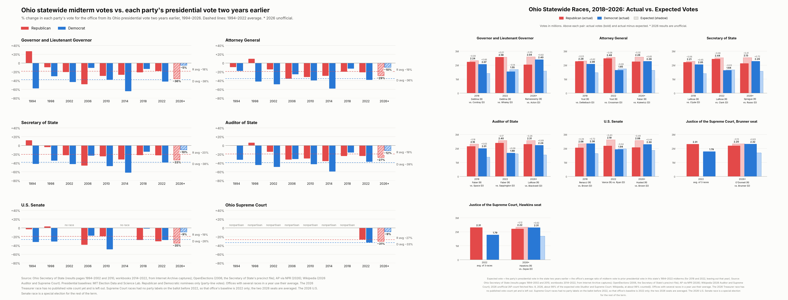

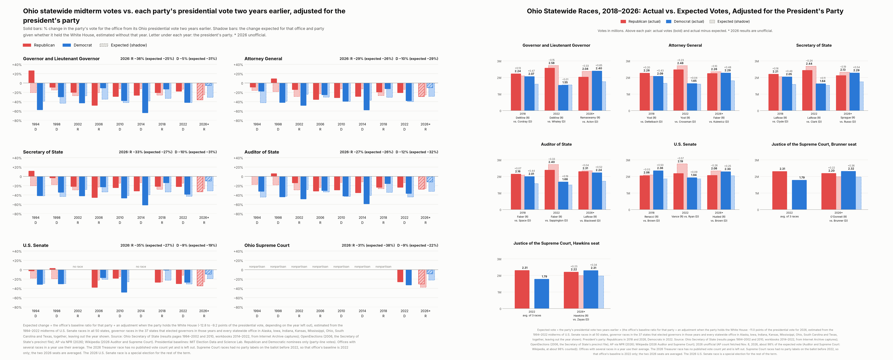

| 2026 race | Republican | vs. expected | vs. adjusted | Democrat | vs. expected | vs. adjusted |
|---|---|---|---|---|---|---|
| Governor and Lieutenant Governor | Vivek Ramaswamy / Rob McColley 2,039,730 | −552K | −345K | Amy Acton / David Pepper 2,404,178 | +824K | +659K |
| Attorney General | Keith Faber 2,256,710 | −317K | −109K | John Kulewicz 2,285,117 | +651K | +486K |
| Secretary of State | Robert Sprague 2,129,981 | −408K | −201K | Allison Russo 2,287,160 | +718K | +553K |
| Auditor of State | Frank LaRose 2,310,105 | −256K | −49K | Annette Blackwell 2,237,955 | +694K | +529K |
| U.S. Senate | Jon Husted 2,077,748 | −492K | −271K | Sherrod Brown 2,301,042 | +438K | +261K |
| Ohio Supreme Court | Dan Hawkins (incumbent) 2,207,874 | −125K | +206K | Marilyn Zayas 2,315,779 | +626K | +362K |

- 2026 count: AP count fetched Nov. 8, 2026, about 98% of the expected vote (Auditor and Supreme Court: Wikipedia, at about 98% counted).
- Sources: Ohio Secretary of State (results pages 1994–2002 and 2010, workbooks 2014–2022, from Internet Archive captures); OpenElections (2006, the Secretary of State's precinct file); AP via NPR (2026); Wikipedia (2026 Auditor and Supreme Court).
- The 2026 Treasurer race has no published vote count yet and is left out. Supreme Court races had no party labels on the ballot before 2022, so that office's baseline is 2022 only; the two 2026 seats are averaged. The 2026 U.S. Senate race is a special election for the rest of the term.
- Inputs: [`data/inputs/OH/`](data/inputs/OH/) (its README lists every source and check); panels: [`figures/oh/panels/`](figures/oh/panels/).
- Write-up: [What moved the Ohio vote in 2026](https://claude.ai/artifact/TxTiFtkTipZ7qrnZkY5Dod)

## Kansas

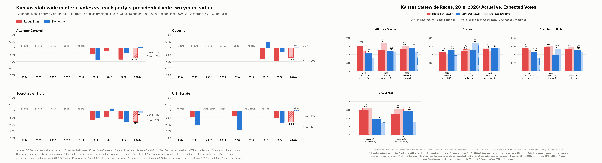

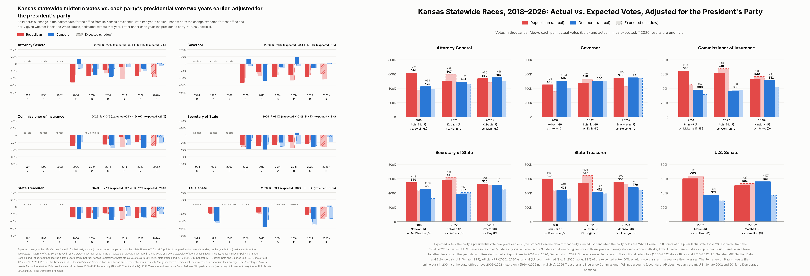

| 2026 race | Republican | vs. expected | vs. adjusted | Democrat | vs. expected | vs. adjusted |
|---|---|---|---|---|---|---|
| Attorney General | Kris Kobach 539,297 | −64K | −12K | Chris Mann 552,753 | +99K | +61K |
| Governor | Ty Masterson 543,612 | +53K | +92K | Cindy Holscher 551,250 | −11K | −39K |
| Secretary of State | Pat Proctor 524,555 | −59K | −6K | Jennifer Day 515,738 | +53K | +15K |
| U.S. Senate | Roger Marshall 505,558 | −110K | −31K | Adam Hamilton 561,143 | +257K | +200K |

- 2026 count: AP count fetched Nov. 8, 2026, about 99% of the expected vote.
- Sources: MIT Election Data and Science Lab (U.S. Senate; 2022 state offices); OpenElections (2014 and 2018 state offices); AP via NPR (2026).
- The Kansas Secretary of State's canvass files could not be fetched automatically, so the state offices rest on secondary sources and have only 2014–2022 history (Governor: 2018 and 2022). Treasurer and Insurance Commissioner are left out (no 2026 count in the AP feed). U.S. Senate 2002 and 2014: no Democratic nominee.
- Inputs: [`data/inputs/KS/`](data/inputs/KS/) (its README lists every source and check); panels: [`figures/ks/panels/`](figures/ks/panels/).
- Write-up: [What moved the Kansas vote in 2026](https://claude.ai/artifact/XmjgDi7jHMVqSthtag5cwZ)

## Iowa

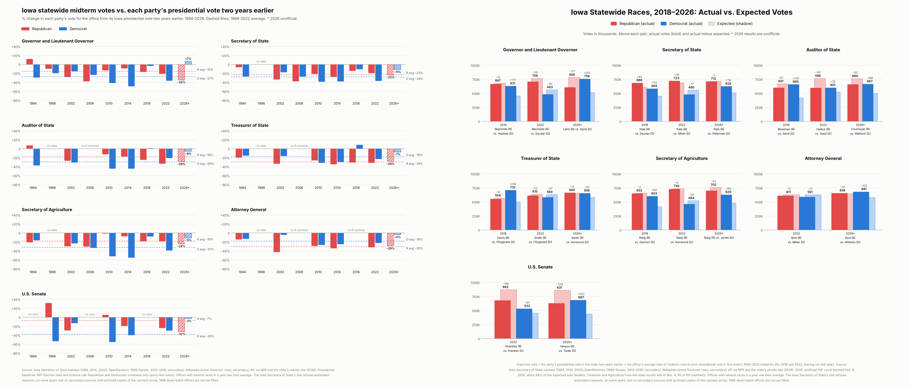

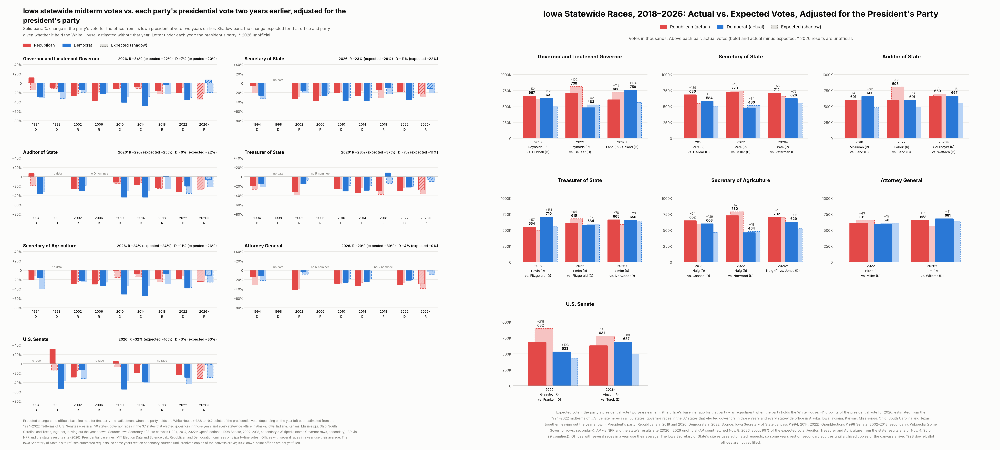

| 2026 race | Republican | vs. expected | vs. adjusted | Democrat | vs. expected | vs. adjusted |
|---|---|---|---|---|---|---|
| Governor and Lieutenant Governor | Zach Lahn 607,591 | −177K | −116K | Rob Sand 757,506 | +243K | +196K |
| Secretary of State | Paul Pate 711,986 | −3K | +53K | Ryan Peterman 625,997 | +116K | +74K |
| Auditor of State | Chris Cournoyer 660,159 | −101K | −36K | Taylor Wettach 666,632 | +168K | +119K |
| Treasurer of State | Roby Smith 664,948 | +11K | +75K | John Norwood 655,763 | +75K | +26K |
| Secretary of Agriculture | Mike Naig 701,882 | −57K | −2K | Chris Jones 629,249 | +150K | +108K |
| Attorney General | Brenna Bird 657,607 | +12K | +89K | Nate Willems 681,255 | +103K | +44K |
| U.S. Senate | Ashley Hinson 630,808 | −229K | −152K | Josh Turek 686,641 | +250K | +191K |

- 2026 count: AP count fetched Nov. 8, 2026, about 99% of the expected vote (Auditor, Treasurer and Agriculture from the state results site of Nov. 4, 95 of 99 counties).
- Sources: Iowa Secretary of State canvass (1994, 2014, 2022); OpenElections (1998 Senate, 2002–2018, secondary); Wikipedia (some Governor rows, secondary); AP via NPR and the state's results site (2026).
- The Iowa Secretary of State's site refuses automated requests, so some years rest on secondary sources until archived copies of the canvass arrive; 1998 down-ballot offices are not yet filled.
- Inputs: [`data/inputs/IA/`](data/inputs/IA/) (its README lists every source and check); panels: [`figures/ia/panels/`](figures/ia/panels/).
- Write-up: [What moved the Iowa vote in 2026](https://claude.ai/artifact/XshXMj9obj9VhsfrsGJF3N)

## Alaska

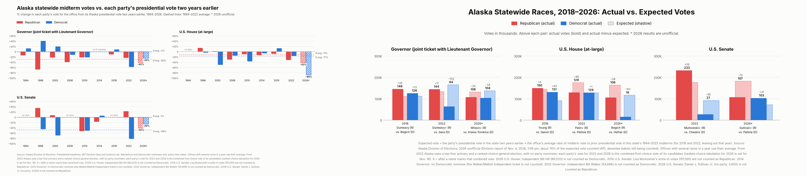

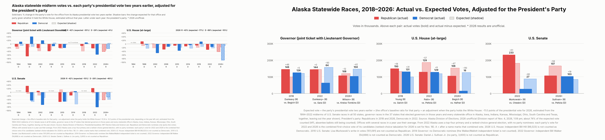

| 2026 race | Republican | vs. expected | vs. adjusted | Democrat | vs. expected | vs. adjusted |
|---|---|---|---|---|---|---|
| Governor (joint ticket with Lieutenant Governor) | Wilson/Shower (R) and other Republicans (first choice) 107,500 | −24K | −13K | Kreiss-Tomkins/Johnson (DEM/NON) 103,837 | −34K | −42K |
| U.S. House (at-large) | Begich, Nick 105,647 | −58K | −47K | Hafner, Eric 15,550 | −101K | −109K |
| U.S. Senate | Sullivan, Dan S. and other Republicans (first choice) 107,171 | −75K | −59K | Peltola, Mary 102,962 | +31K | +19K |

- 2026 count: Division report of Nov. 4, 2026, 1:09 pm; about 74% of the expected vote counted (AP), absentee ballots still being counted.
- Sources: Alaska Division of Elections.
- From 2022 Alaska uses a top-four primary and a ranked-choice general election, with no party nominees: each party's vote for 2022 and 2026 is the combined first-choice vote of its candidates (ranked-choice tabulation for 2026 is set for Nov. 18). A + after a name marks that combined vote.
- 2026 U.S. House: independent Bill Hill (86,023) is not counted as Democratic. 2010 U.S. Senate: Lisa Murkowski's write-in votes (101,091) are not counted as Republican. 2014 Governor: no Democratic nominee (the Walker/Mallott independent ticket is not counted). 2022 Governor: independent Bill Walker (54,668) is not counted as Democratic. 2026 U.S. Senate: Daniel J. Sullivan Jr. (no party, 3,600) is not counted as Republican.
- Inputs: [`data/inputs/AK/`](data/inputs/AK/) (its README lists every source and check); panels: [`figures/ak/panels/`](figures/ak/panels/).
- Write-up: [What moved the Alaska vote in 2026](https://claude.ai/artifact/EYRgFH2onscg5JJcSncTgY)

## Mississippi

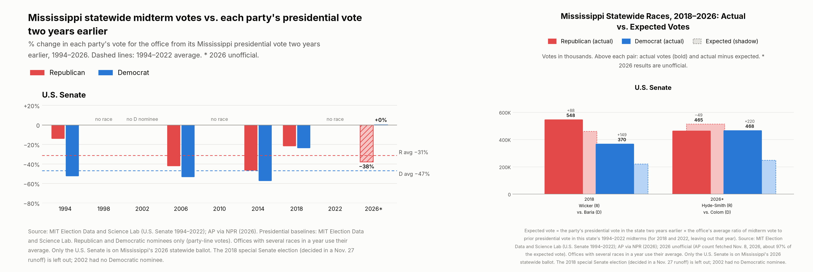

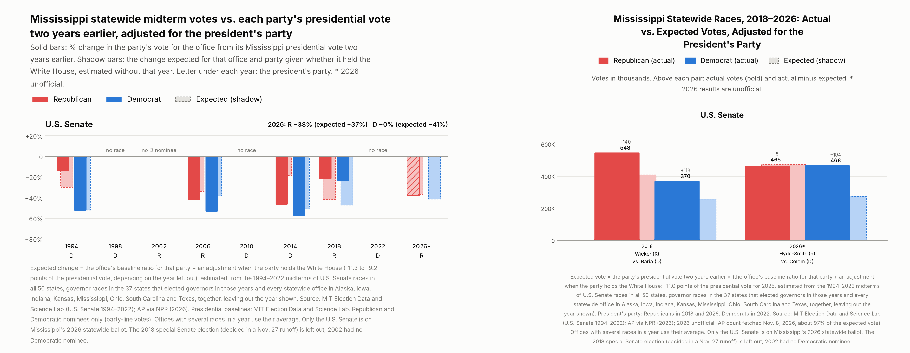

| 2026 race | Republican | vs. expected | vs. adjusted | Democrat | vs. expected | vs. adjusted |
|---|---|---|---|---|---|---|
| U.S. Senate | Cindy Hyde-Smith 465,356 | −49K | −10K | Scott Colom 467,930 | +220K | +196K |

- 2026 count: AP count fetched Nov. 8, 2026, about 97% of the expected vote.
- Sources: MIT Election Data and Science Lab (U.S. Senate 1994–2022); AP via NPR (2026).
- Only the U.S. Senate is on Mississippi's 2026 statewide ballot. The 2018 special Senate election (decided in a Nov. 27 runoff) is left out; 2002 had no Democratic nominee.
- Inputs: [`data/inputs/MS/`](data/inputs/MS/) (its README lists every source and check); panels: [`figures/ms/panels/`](figures/ms/panels/).
- Write-up: [What moved the Mississippi vote in 2026](https://claude.ai/artifact/4V6xZVmCcHVQhwD1fDFpKd)

## South Carolina

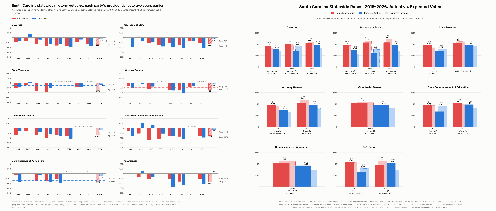

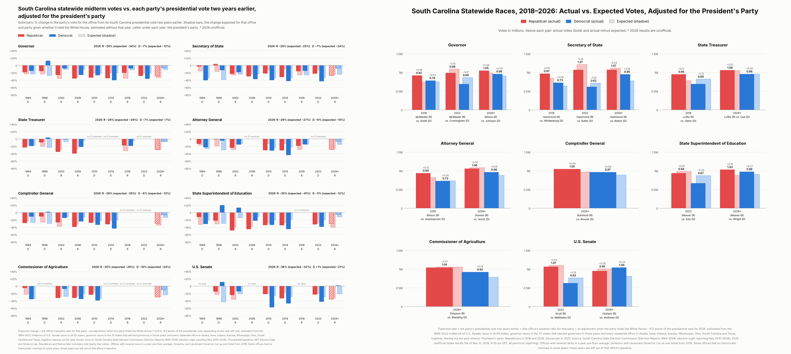

| 2026 race | Republican | vs. expected | vs. adjusted | Democrat | vs. expected | vs. adjusted |
|---|---|---|---|---|---|---|
| Governor | Alan Wilson / Mike Reichenbach 1,051,010 | −37K | +60K | Jermaine Johnson / Sam Skardon 960,269 | +123K | +56K |
| Secretary of State | Mark Hammond 1,073,652 | −141K | −45K | Jason Belton 952,186 | +246K | +179K |
| State Treasurer | Curtis Loftis 1,062,666 | −51K | +11K | Vincent Coe 959,539 | +47K | +4K |
| Attorney General | David Stumbo 1,059,358 | −130K | −27K | Richard Hricik 964,921 | +164K | +92K |
| Comptroller General | Mike Burkhold 1,048,553 | −28K | +76K | Tiffany Boozer 965,075 | +150K | +79K |
| State Superintendent of Education | Ellen Weaver 1,032,516 | +36K | +146K | Sylvia Wright 976,406 | +150K | +73K |
| Commissioner of Agriculture | Cody Simpson 1,042,601 | −95K | −18K | DeShawn Blanding 922,961 | +197K | +143K |
| U.S. Senate | Darline Graham 951,896 | −184K | −60K | Annie Andrews 1,043,712 | +325K | +239K |

- 2026 count: state results file of Nov. 6, 2026, 6:25 pm EST, all precincts reporting.
- Sources: South Carolina State Election Commission (Election Reports 1994–2006, election-night reporting files 2010–2026).
- Governor and Lieutenant Governor run as one ticket from 2018. Some offices had no Democratic nominee in some years; those years are left out of that office's baseline.
- Inputs: [`data/inputs/SC/`](data/inputs/SC/) (its README lists every source and check); panels: [`figures/sc/panels/`](figures/sc/panels/).
- Write-up: [What moved the South Carolina vote in 2026](https://claude.ai/artifact/QR3PRnaGkL9an8j9cXzMbf)

## Indiana

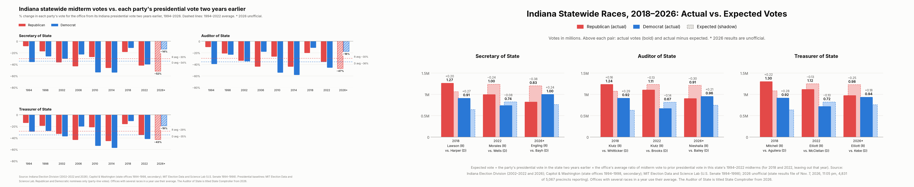

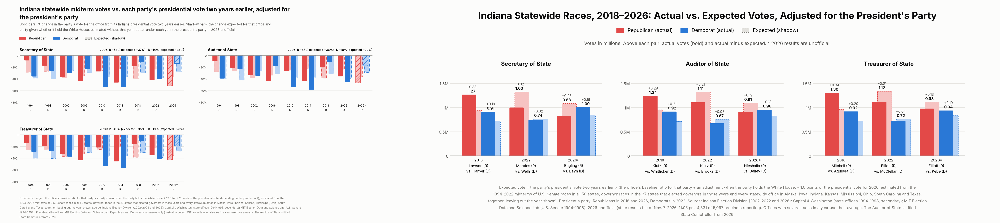

| 2026 race | Republican | vs. expected | vs. adjusted | Democrat | vs. expected | vs. adjusted |
|---|---|---|---|---|---|---|
| Secretary of State | Max Engling 826,017 | −376K | −264K | Beau Bayh 1,004,067 | +242K | +166K |
| Auditor of State | Elise Nieshalla 906,914 | −305K | −193K | Jessica Bailey 956,408 | +209K | +133K |
| Treasurer of State | Daniel Elliott 977,791 | −250K | −138K | Coumba Kebe 938,209 | +181K | +105K |

- 2026 count: state results file of Nov. 7, 2026, 11:05 pm, 4,831 of 5,067 precincts reporting.
- Sources: Indiana Election Division (2002–2022 and 2026); Capitol & Washington (state offices 1994–1998, secondary); MIT Election Data and Science Lab (U.S. Senate 1994–1998).
- The Auditor of State is titled State Comptroller from 2026.
- Inputs: [`data/inputs/IN/`](data/inputs/IN/) (its README lists every source and check); panels: [`figures/in/panels/`](figures/in/panels/).
- Write-up: [What moved the Indiana vote in 2026](https://claude.ai/artifact/4VcgQGmKS1dT6We2xXuTpm)

## Rebuild

```
pip install -r requirements.txt
./build.sh          # rebuild into build/ and compare with data/derived and figures
python3 src/fetch_sources.py   # re-download every source with a URL and compare sha256
```

## Layout

- `data/inputs/` — what the code reads: `presidential_1992_2024.csv` and `<ST>/statewide_results.csv` (one row per race,
  with source URL, file, sha256, cross-check and notes) plus each state's README.
- `data/raw/` — the downloaded source files (10 MB or less); `data/SOURCES.csv` lists every source with URL and sha256,
  including larger files that are not copied.
- `data/derived/` — the computed tables; `figures/` — the figures; `site/` — the web page builder.
- `src/expected.py` (the computation), `src/figs.py` (figures), `src/build_states.py` (all states), `src/verify.py`.

Texas inputs are included because Texas is part of the pooled president's-party estimate; the Texas figures and raw files are in
[texas-2026-midterm-expected-vote](https://github.com/kevinnbass/texas-2026-midterm-expected-vote).
